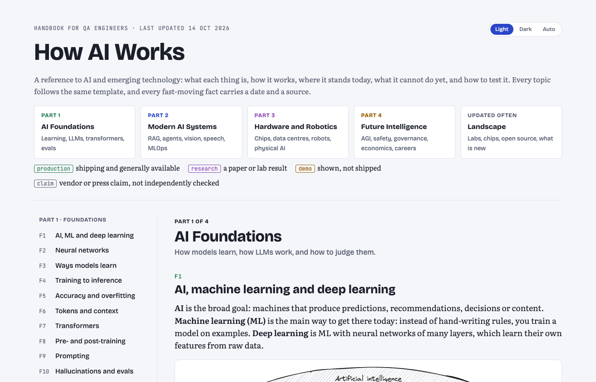

# How AI Works

An AI and emerging-technology handbook for QA engineers: 58 topics, each in the same template, from neural networks to robots, regulation and the current industry landscape.

  

> **Read it online: [chethanbhatbs.github.io/ai-handbook](https://chethanbhatbs.github.io/ai-handbook/)**. No login, no download. Every chapter below links straight to its section.

---

## Chapters (58)

| Part | Chapters | Jump to |
|---|---:|---|
| **Part 1 · Foundations** | 10 | [F1 AI, ML and deep learning](https://chethanbhatbs.github.io/ai-handbook/#ai-ml-dl) · [F2 Neural networks](https://chethanbhatbs.github.io/ai-handbook/#nn) · [F3 Ways models learn](https://chethanbhatbs.github.io/ai-handbook/#learning) · [F4 Training to inference](https://chethanbhatbs.github.io/ai-handbook/#lifecycle) · [F5 Accuracy and overfitting](https://chethanbhatbs.github.io/ai-handbook/#metrics) · [F6 Tokens and context](https://chethanbhatbs.github.io/ai-handbook/#tokens) · [F7 Transformers](https://chethanbhatbs.github.io/ai-handbook/#transformers) · [F8 Pre- and post-training](https://chethanbhatbs.github.io/ai-handbook/#training) · [F9 Prompting](https://chethanbhatbs.github.io/ai-handbook/#prompting) · [F10 Hallucinations and evals](https://chethanbhatbs.github.io/ai-handbook/#evals) |
| **Part 2 · Modern systems** | 15 | [M1 RAG](https://chethanbhatbs.github.io/ai-handbook/#rag) · [M2 RAG vs fine-tune vs context](https://chethanbhatbs.github.io/ai-handbook/#rag-vs) · [M3 Agents](https://chethanbhatbs.github.io/ai-handbook/#agents) · [M4 MCP and tools](https://chethanbhatbs.github.io/ai-handbook/#mcp) · [M5 Agent evals](https://chethanbhatbs.github.io/ai-handbook/#agent-evals) · [M6 Vision and images](https://chethanbhatbs.github.io/ai-handbook/#vision) · [M7 Speech and audio](https://chethanbhatbs.github.io/ai-handbook/#speech) · [M8 NLP](https://chethanbhatbs.github.io/ai-handbook/#nlp) · [M9 Multimodal](https://chethanbhatbs.github.io/ai-handbook/#multimodal) · [M10 Recommenders](https://chethanbhatbs.github.io/ai-handbook/#recsys) · [M11 Self-driving](https://chethanbhatbs.github.io/ai-handbook/#driving) · [M12 AI engineering](https://chethanbhatbs.github.io/ai-handbook/#ai-eng) · [M13 Decision models (Jev)](https://chethanbhatbs.github.io/ai-handbook/#jev) · [M14 Data engineering](https://chethanbhatbs.github.io/ai-handbook/#data-eng) · [M15 MLOps and LLMOps](https://chethanbhatbs.github.io/ai-handbook/#mlops) |
| **Part 3 · Hardware, robotics** | 14 | [H1 AI chips](https://chethanbhatbs.github.io/ai-handbook/#chips) · [H2 Training vs inference](https://chethanbhatbs.github.io/ai-handbook/#train-infer-hw) · [H3 Cloud, device, edge](https://chethanbhatbs.github.io/ai-handbook/#edge) · [H4 Memory and bandwidth](https://chethanbhatbs.github.io/ai-handbook/#memory) · [H5 Making models smaller](https://chethanbhatbs.github.io/ai-handbook/#optimise) · [H6 Data centres](https://chethanbhatbs.github.io/ai-handbook/#datacentres) · [H7 Chip manufacturing](https://chethanbhatbs.github.io/ai-handbook/#semis) · [H8 Robotics basics](https://chethanbhatbs.github.io/ai-handbook/#robotics) · [H9 Robot types](https://chethanbhatbs.github.io/ai-handbook/#robot-types) · [H10 ROS 2](https://chethanbhatbs.github.io/ai-handbook/#ros) · [H11 Vision-language-action](https://chethanbhatbs.github.io/ai-handbook/#vla) · [H12 Simulation](https://chethanbhatbs.github.io/ai-handbook/#sim) · [H13 Robot learning](https://chethanbhatbs.github.io/ai-handbook/#robot-learning) · [H14 Robot safety testing](https://chethanbhatbs.github.io/ai-handbook/#robot-safety) |
| **Part 4 · Future** | 14 | [X1 AGI](https://chethanbhatbs.github.io/ai-handbook/#agi) · [X2 Capabilities and gaps](https://chethanbhatbs.github.io/ai-handbook/#gaps) · [X3 Self-improvement](https://chethanbhatbs.github.io/ai-handbook/#rsi) · [X4 Predictions](https://chethanbhatbs.github.io/ai-handbook/#predictions) · [X5 Society and work](https://chethanbhatbs.github.io/ai-handbook/#society) · [X6 Bias, privacy, copyright](https://chethanbhatbs.github.io/ai-handbook/#bias) · [X7 AI security](https://chethanbhatbs.github.io/ai-handbook/#ai-security) · [X8 Alignment](https://chethanbhatbs.github.io/ai-handbook/#alignment) · [X9 Regulation](https://chethanbhatbs.github.io/ai-handbook/#regulation) · [X10 Human oversight](https://chethanbhatbs.github.io/ai-handbook/#oversight) · [X11 AI economics](https://chethanbhatbs.github.io/ai-handbook/#economics) · [X12 Research frontiers](https://chethanbhatbs.github.io/ai-handbook/#research) · [X13 Adjacent tech](https://chethanbhatbs.github.io/ai-handbook/#adjacent) · [X14 Careers](https://chethanbhatbs.github.io/ai-handbook/#careers) |
| **Landscape · Oct 2026** | 5 | [L1 AI labs and model families](https://chethanbhatbs.github.io/ai-handbook/#labs) · [L2 Hardware companies](https://chethanbhatbs.github.io/ai-handbook/#hw-cos) · [L3 Open-source communities](https://chethanbhatbs.github.io/ai-handbook/#oss) · [L4 What's new in 2025-26](https://chethanbhatbs.github.io/ai-handbook/#advances) · [L5 Demo or product?](https://chethanbhatbs.github.io/ai-handbook/#claims) |

---

## How to read

### 1 · In your browser
Open **[https://chethanbhatbs.github.io/ai-handbook/](https://chethanbhatbs.github.io/ai-handbook/)**, or click any chapter link above. The side menu jumps between chapters, and the switch in the top right changes between light and dark mode.

### 2 · On your phone
The page reflows for phone screens. Wide diagrams and tables scroll sideways inside their own box.

### 3 · Offline
Download [`index.html`](index.html) (it is one self-contained file) and open it in any browser. Fonts and the diagram library load from the internet the first time, so the very first open needs a connection.

---

## About the content

Fast-moving facts are dated and tagged production, research, demo, claim or reported. Last updated 14 Oct 2026; they will go out of date, so check the linked sources.

## Source and design

- `index.html` is the page itself, served by GitHub Pages. Every push to `main` redeploys it.
- `src/` holds the editable source.
- Diagrams are drawn with [rough.js](https://roughjs.com) in the Excalidraw style, using the Virgil font from [Excalidraw](https://github.com/excalidraw/excalidraw) (SIL Open Font License). Code examples are coloured with [Prism](https://prismjs.com).
- The AI handbook is generated: topic data lives in `src/p1.py` to `src/p4.py` and `src/landscape.py`, and `src/gen.py` builds the page. The generator reads its page shell and font from local paths set at the top of `gen.py`; adjust those to rebuild.
