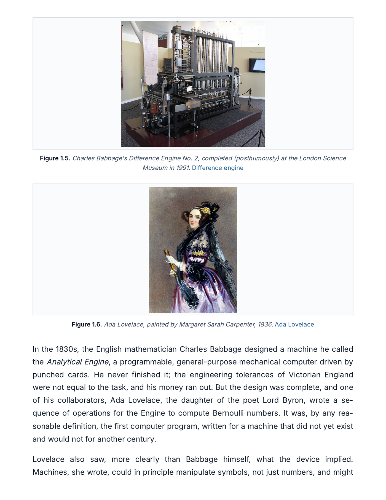

# Python Mastery

> A long-form study of Python in two volumes: a textbook that begins not with code but with the machine, and a working handbook that turns the lessons into daily practice.

<p align="center">
  <br/>
  <em>Chapter 1, page 9. The textbook traces five thousand years of calculating machines before the first line of Python.</em>
</p>

> 👉 **For the styled landing page, open `index.html` in a browser** — broadsheet editorial layout, the same place a visitor would land if this site were deployed.

A long-form study, meant to be read, not skimmed. In progress, written in public, and shared free. The aim is to earn shelf space alongside *Fluent Python*, *Python Crash Course*, and the official tutorial — as a complement, not a replacement.

## The Library

| Stage | Title | Pages | View HTML | Download PDF | Status |
|-------|-------|------:|-----------|--------------|--------|
| Volume I · Flagship | **The Python Book** | ~125 | [`python-mastery.html`](python-mastery.html) | [`Python-Mastery.pdf`](Python-Mastery.pdf) | 🚧 6 of 22 chapters |
| Volume II · Companion | **The Python Handbook** | ~50 | [`python-handbook.html`](python-handbook.html) | [`Python-Handbook.pdf`](Python-Handbook.pdf) | 🚧 6 of 24 modules |

### What's in each book

**The Python Book** (`python-mastery.html`) — A textbook that does not begin with Python. The first three chapters cover the machine itself (von Neumann architecture, memory hierarchy, IEEE 754, the call stack), the lineage of the language (FORTRAN through ABC, C, Modula-3 into Python; CPython's compilation pipeline, the GIL), and the object model that unifies everything Python does (identity/type/value, the names-not-boxes binding model, mutability, equality vs identity, the data model dunder protocol). Only then do the chapters on numbers and strings begin. Real photographs from Wikimedia Commons, inline SVG diagrams, numbered examples and exercises, and full worked solutions at the end of every chapter.

**The Python Handbook** (`python-handbook.html`) — The practical companion. A module-by-module reference structured around seven sections per module: concept, definition, worked examples (commented code with output), **edge cases &amp; common errors** with real tracebacks, **think about it** prompts that hide the reasoning behind a reveal, a quick-reference table, and exercises with revealable answers. Opens with **The Learning Path**: 3 tiers and 12 stages from beginner to advanced.

## How to read

Three options. Pick whichever fits the moment.

- **In a browser.** Clone the repo (or download) and open either `.html` file. Each is fully self-contained — no build, no dependencies, no network requests for fonts work fine offline once cached.
- **As a PDF.** Open `Python-Mastery.pdf` or `Python-Handbook.pdf` for the same content in print-ready form.
- **On mobile.** Both HTML files are responsive; the textbook collapses its sidebar under 1024px.

## Browser preview (rendering the HTML, not the source)

When the repo is **private**, the convenient third-party previewers like `htmlpreview.github.io` and `raw.githack.com` will not work — they need public raw access. There are four paths:

1. **Make the repo public** *(free, simplest).* Then the rendered HTML is available at:
   `https://htmlpreview.github.io/?https://github.com/chethanbhatbs/python-mastery/blob/main/python-mastery.html`
2. **GitHub Pages on Pro / Team / Enterprise** *(paid).* GitHub Pages cannot serve private repos on the free tier.
3. **Cloudflare Pages** *(recommended free path).* Connects to a private GitHub repo, serves the HTML directly, and gives a `pages.dev` URL within seconds. See `DEPLOY.md`.
4. **Netlify** *(also free, also supports private repos).* Same idea, slightly heavier UI. See `DEPLOY.md`.

The full step-by-step for all four is in [`DEPLOY.md`](DEPLOY.md).

## How it was made

- Books are written as long-form **HTML by hand**, with embedded CSS and inline SVG diagrams. No site generator.
- PDFs are produced from the HTML via headless Chrome:
  ```
  /Applications/Google\ Chrome.app/Contents/MacOS/Google\ Chrome \
    --headless --disable-gpu --no-pdf-header-footer \
    --print-to-pdf=Python-Mastery.pdf \
    file://$PWD/python-mastery.html
  ```
- Cover thumbnails and the feature page are rendered by [`scripts/render_covers.py`](scripts/render_covers.py) using `pdf2image` (which depends on Poppler). The script is reproducible: install once into a venv, run, commit.
- Photographs are loaded from Wikimedia Commons via stable URLs and credited in every figure caption.

## Repository layout

```
python-mastery.html         The textbook (Volume I)
python-handbook.html        The handbook (Volume II)
Python-Mastery.pdf          PDF of the textbook
Python-Handbook.pdf         PDF of the handbook
index.html                  Broadsheet landing page (open in a browser)
README.md                   This file
DEPLOY.md                   Step-by-step deployment guide
netlify.toml                Netlify build config
_headers                    Cache-control headers (Cloudflare Pages + Netlify)
_redirects                  Short-URL aliases
scripts/render_covers.py    Reproduces docs/images/* from the PDFs
docs/images/                Cover thumbnails and the feature page
```
